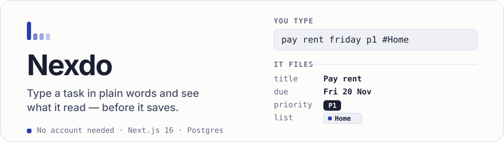
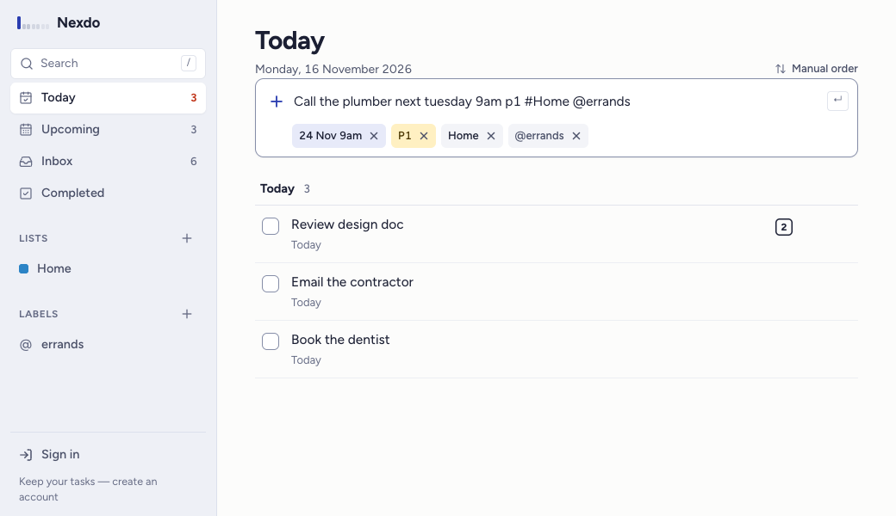
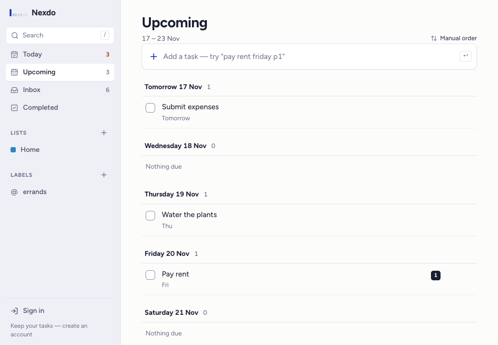

<p align="center">
  
</p>

<p align="center">
  <strong><a href="https://nexdo-woad.vercel.app">nexdo-woad.vercel.app</a></strong>
  &nbsp;·&nbsp; no sign-up — start typing
  &nbsp;·&nbsp; <a href="MILESTONES.md">build log</a>
</p>

## It shows you what it understood

One line in. Four fields out, each one removable before you commit to it — so the parse is never a
guess you discover later.



Four fixed views, lists, labels, priorities, recurrence, drag ordering and search across titles and
notes sit behind it. `Upcoming` is seven dated days, including the empty ones — a quiet day is
information too.



## Try it without an account

Open the link and type. Nothing asks who you are, and the work is yours the moment you sign in later:

```
first mutation ──> mint Owner(kind: GUEST) + set httpOnly cookie
                   store only sha256(token); the cookie is the secret

sign in        ──> same Owner row, flipped to kind: USER
                   one UPDATE; no task row moves
```

Identity is a `Principal`, not a user id:

```ts
type Principal =
  | { kind: "user"; ownerId; timeZone } // signed in
  | { kind: "guest"; ownerId; timeZone } // cookie + Owner row
  | { kind: "none" }; // nothing written yet
```

Every service function takes one and filters every query on its `ownerId`, so a guest and a signed-in
user produce the same query — there is no second code path to keep in step. Two consequences worth
knowing:

- **The owner is minted on the first _mutation_, never on a page view.** A cookie cannot be set from a
  Server Component, so the platform enforces this. A crawler that only issues GETs writes nothing.
- **Authorization is the `ownerId` in the `WHERE` clause.** Mutations use `updateMany` rather than
  `update` so the owner can be part of the filter: a guessed id updates zero rows. Row-level security
  is enabled on every table as a backstop, not as the model.

If you already had an account and sign in as a guest, the two sets are merged rather than one
replacing the other. Clearing cookies before signing in makes guest work unreachable, and the app says
so plainly rather than implying otherwise.

> **The live deployment runs on Clerk's development instance.** Those keys have usage limits and are
> not origin-locked, so devtools will show a warning. A production instance needs DNS on a domain I
> control plus my own Google OAuth app — real work that teaches nothing about this codebase, so it is
> deliberately skipped.

## What is actually hard here

None of it is the task list.

- **"Today" is a calendar concept, not a timestamp.** A due date is stored as `YYYY-MM-DD` text and
  "due today" is computed in the _user's_ zone. Because the server renders these views, that zone has
  to be data on the user's record rather than whatever `new Date()` returns in the deploy region —
  otherwise every date boundary is wrong for most of the world. Exactly one function reads a clock,
  `todayIn(zone)`, it refuses to run without a zone, and everything else is string arithmetic.
- **Recurrence regenerates rather than repeats.** Completing an occurrence creates the next one, which
  supports rules like "3 days after I last did this". `RRULE` cannot express that, so the rule is a
  small typed union instead. Only one occurrence of a series is ever open, which is what lets undo
  withdraw the occurrence a completion created.
- **Ordering is a fractional index, not a position integer.** Moving one row writes one row.
- **Perceived latency decides whether a todo app gets used.** Anything that changes _which_ rows are
  shown paints within a frame, and a failure reverts visibly rather than leaving a row looking saved.

## How a read and a write actually run

```
READ · Server Component
  request → getPrincipal() (React.cache'd) → today = todayIn(owner.timeZone)
          → taskService.tasksForView(principal, view, today)
          → Prisma, filtered by ownerId → streamed into a Suspense boundary

WRITE · Server Action
  click → useOptimistic applies it to the list immediately
        → action: getPrincipal + Zod parse + capability check
        → taskService mutates (ownerId in the WHERE)
        → revalidatePath("/", "layout") — every view can show the row
        → optimistic state is discarded when the real payload lands
```

Reads are Server Components and writes are Server Actions, so there is no API layer and no client
fetching state. The one exception is search, which hits `GET /api/search` through TanStack Query
because it needs a response per keystroke with caching across them.

`useOptimistic` lives at the **list**, not the row: completing a task removes it from the view, and a
row cannot remove itself from its parent's array.

## Keyboard

Operable without a mouse. Press <kbd>?</kbd> for the list, which is rendered from the same array the
bindings are defined in (`src/lib/shortcuts.ts`), so it cannot drift.

| Key                         | Does                              |
| --------------------------- | --------------------------------- |
| <kbd>⌘K</kbd>               | Command palette — views and lists |
| <kbd>/</kbd>                | Search tasks and notes            |
| <kbd>N</kbd>                | New task                          |
| <kbd>J</kbd> <kbd>K</kbd>   | Move between tasks, from anywhere |
| <kbd>↑</kbd> <kbd>↓</kbd>   | Move between tasks, once focused  |
| <kbd>Space</kbd>            | Complete or reopen                |
| <kbd>Enter</kbd>            | Open details                      |
| <kbd>E</kbd>                | Rename in place                   |
| <kbd>⌥↑</kbd> <kbd>⌥↓</kbd> | Reorder, under manual sort        |
| <kbd>⌫</kbd>                | Delete, with undo                 |

Rows take real DOM focus with a roving `tabindex` — exactly one row is in the tab order, so Tab enters
the list in a single stop — and focus moves to the next row when the focused one is completed rather
than falling to the body. Arrows only act once a row holds focus, so <kbd>↓</kbd> still scrolls the
page everywhere else; <kbd>J</kbd>/<kbd>K</kbd> are the way in, because they are never a scroll
gesture. All motion is behind `prefers-reduced-motion`.

## Stack

| Layer    | Choice                                                                                                               |
| -------- | -------------------------------------------------------------------------------------------------------------------- |
| Frontend | Next.js App Router, React 19, TypeScript strict, Tailwind v4 (CSS-first), shadcn/ui, Lucide, Figtree via `next/font` |
| Backend  | Supabase Postgres via Prisma 7 (driver adapter), Server Actions over a service layer                                 |
| Auth     | Clerk — additive, because of the `Principal` abstraction above                                                       |
| Client   | `useOptimistic` + `useTransition`; TanStack Query for search only; React Hook Form + Zod in the detail panel         |
| Parsing  | `chrono-node`, loaded on first keystroke                                                                             |
| Hosting  | Vercel, with a daily cron that prunes abandoned guest accounts                                                       |
| Testing  | Vitest, run under four time zones                                                                                    |

## Running it

```bash
corepack pnpm install
cp .env.example .env    # then fill in Supabase and Clerk
corepack pnpm dev       # http://localhost:3033
```

`pnpm` may not be on your PATH; `corepack pnpm` works without installing anything. Every variable is
documented in [`.env.example`](.env.example), including why the app and the migrations need different
connection strings — the app uses Supabase's transaction pooler on `:6543`, while `prisma migrate`
cannot run over transaction pooling and needs a direct connection on `:5432`.

| Script                | What it does                                                                        |
| --------------------- | ----------------------------------------------------------------------------------- |
| `dev`                 | Dev server on `localhost:3033`                                                      |
| `dev:utc`             | Same, with the server in UTC — reproduces the production time-zone mismatch locally |
| `build` / `start`     | Production build and serve                                                          |
| `check`               | typecheck + lint + format check + unit tests                                        |
| `test` / `test:watch` | Vitest                                                                              |
| `test:tz`             | The unit suite under four `TZ` values                                               |
| `analyze`             | Bundle treemap                                                                      |

`dev:utc` and `test:tz` are the two worth knowing about. Normally your dev server and browser share a
time zone, which is exactly the condition that hides every date bug above. Running the server in UTC
while the browser reports your real zone reproduces what production looks like.

## Testing

The unit suite covers the logic worth asserting: calendar arithmetic across four time zones, the
capture parser including its deliberate non-parses, recurrence, and fractional ordering. UI behaviour
is checked by looking at it.

That split is deliberate. The pure logic is where this app is actually hard — a date that is correct
in one zone and wrong in another will not announce itself — and it is also the part a test can pin
down cheaply. Rendering and navigation are faster to verify by opening them.

Decisions, dead ends and the bugs that changed the design are in [MILESTONES.md](MILESTONES.md).
